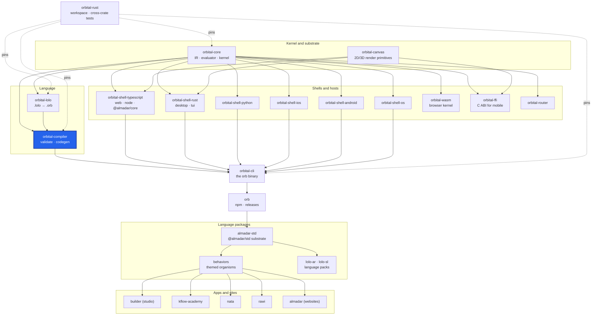

<div align="center">

# orbital-compiler

**The L2 compiler: validates an `.orb` program, resolves composition, and hands the IR to a shell backend to generate code.**

[](https://github.com/almadar-io/orbital-compiler/actions/workflows/ci.yml) [](LICENSE)

</div>

`orbital-compiler` takes a parsed schema through Parse, Validate, Enrich, Inline, Compose and Resolve, produces the OIR, and drives code generation through a shell backend. It validates and generates; it never decides runtime behavior, which lives in `orbital-core`.

## Where this fits



| Upstream (this repo depends on) | Downstream (depends on this repo) |
|---|---|
| [orbital-core](https://github.com/almadar-io/orbital-core): IR types, evaluator and language data (`orbital-core-base`, `orbital-core-eval`) | [orbital-cli](https://github.com/almadar-io/orbital-cli): the `orb` binary validates, composes and generates through this crate |
| | [orbital-integration-tests](https://github.com/almadar-io/orbital-integration-tests): cross-crate tests compile programs through the shells |

[orbital-lolo](https://github.com/almadar-io/orbital-lolo) produces the `.orb` this crate reads; the two are siblings with no crate dependency between them, so a check both need lives in `orbital-core`. Shells never depend on the compiler.

## Quick start

```bash
npm install --no-save --no-package-lock @almadar/core @almadar/std @almadar/lolo-ar @almadar/lolo-sl
cargo test
```

As a library (see `src/lib.rs`): `compile_file` returns the OIR, and `generate_from_file` writes generated code through a `Backend`. For the command line, use `orb` ([orbital-cli](https://github.com/almadar-io/orbital-cli)).

## What's inside

Directories under `src/` are organizational only: modules are declared with `#[path]` so public paths stay flat (`orbital_compiler::type_infer`).

| Path | Role |
|---|---|
| `src/phases/` | The pipeline: `parse`, `inline`, `compose`, `enrich`, `validate` and `validation/`, `resolve`, `nominalize`, `lazy`, `reflect` |
| `src/composition/` | Composing behaviors into an app: `compose_behaviors`, `compose_app`, event wiring, layout strategy |
| `src/loader/` | Resolves `uses` imports |
| `src/inference/` | Expression type inference (`type_infer`, `ir_helpers`) |
| `src/codegen/` | IR handed to a shell backend: `generate`, `mixed`, `shell` |
| `src/testing/` | The exhaustive-test generator |
| `src/bin/compose_only.rs` | The `compose_only` binary: runs `compose_behaviors` on a JSON fixture and prints the schema |
| `tests/` | One integration test file per rule, plus `fixtures/` |

## Development

The crate reads the Almadar language data (patterns, operators, themes, vocabularies) from installed npm packages, so install those first (this is the CI recipe; the toolchain is pinned to Rust 1.93.0 in `rust-toolchain.toml`):

```bash
npm install --no-save --no-package-lock @almadar/core @almadar/std @almadar/lolo-ar @almadar/lolo-sl
cargo test
```

Its `orbital-*` dependencies are git dependencies on the `main` branch of their own repos.

Open gaps are tracked in [Almadar_Gaps.md](Almadar_Gaps.md). Work on `main`; never create a feature branch. Inside the monorepo this repo is the submodule `orbital-rust/crates/orbital-compiler`; work from `orbital-rust` with `cargo test -p orbital-compiler`.

## Docs

- [Orb documentation](https://orb.almadar.io/docs): the language, the `orb` CLI and how the pieces fit

## License

[Business Source License 1.1](LICENSE): free for non-commercial use and internal evaluation; commercial production use needs a licence from Almadar FZE. Converts to Apache-2.0 on 2030-02-01.
